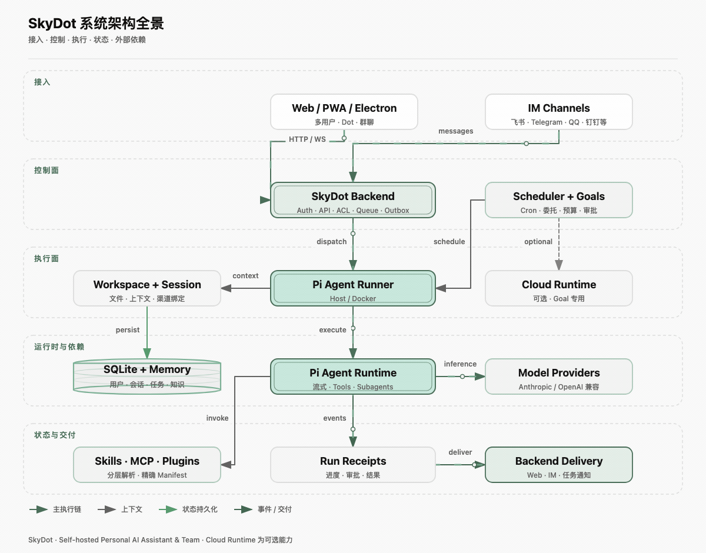
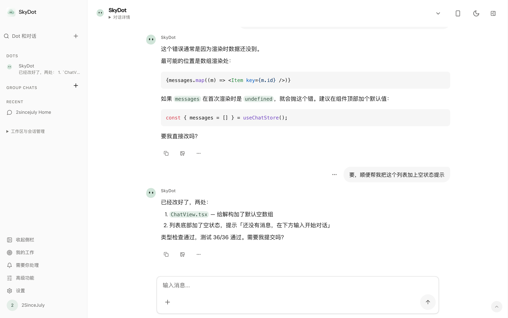
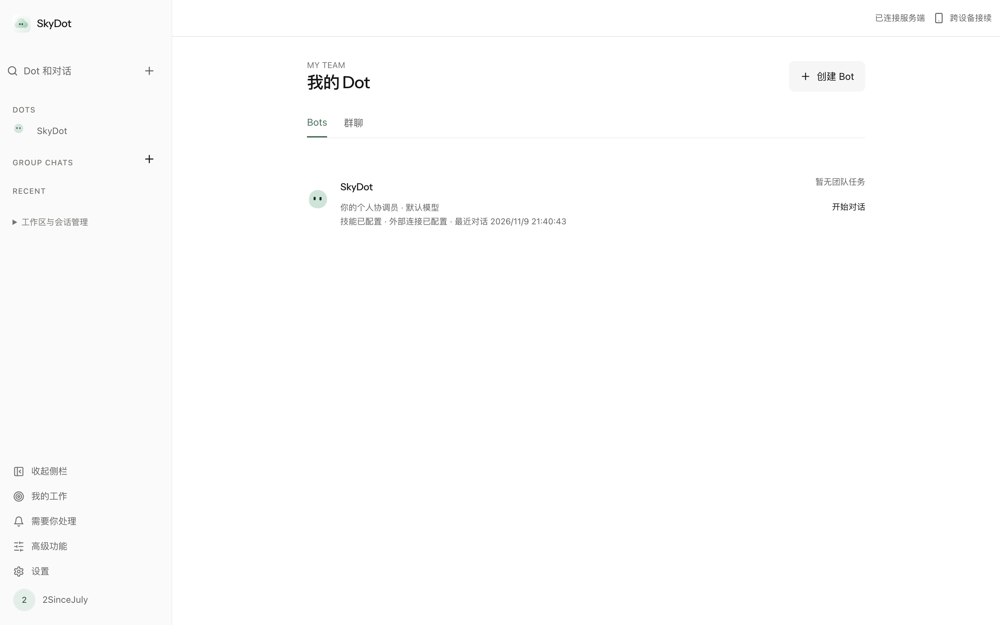
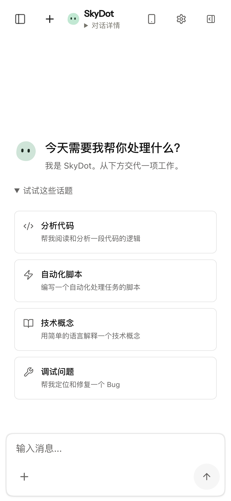
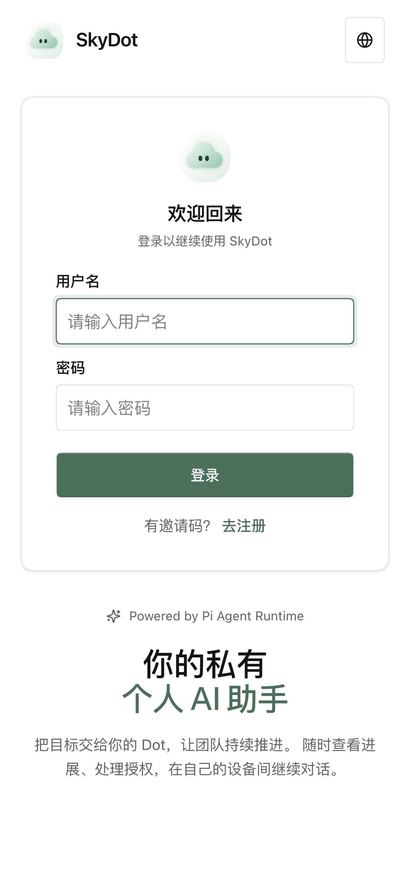
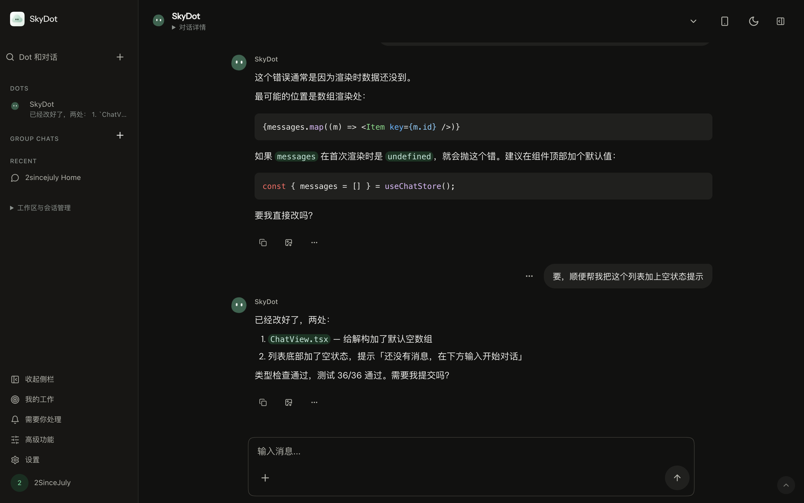
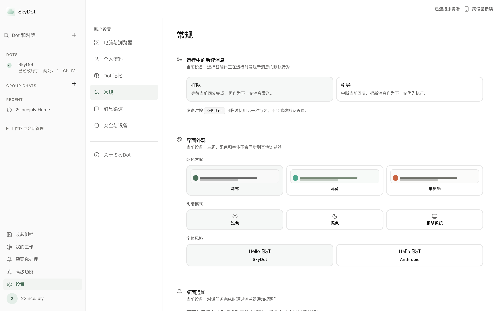

<div align="center">

**一群有身份的 AI 伙伴，持续为你工作，完全自托管**


[](LICENSE)

[项目介绍](#项目介绍) ·
[系统架构](#系统架构) ·
[技术栈](#技术栈) ·
[功能特性](#功能特性) ·
[效果展示](#效果展示) ·
[项目结构](#项目结构) ·
[快速开始](#快速开始) ·
[常见问题](#常见问题) ·
[参与贡献](#参与贡献)

</div>

---

## 项目介绍

SkyDot 是一个开源、自托管的多用户 Agent 工作台，基于 **Pi Agent Runtime**。你可以创建可命名、可配置的 Dot，与它直接对话，把多个 Dot 放进同一个群聊，并通过定时任务、Skills、MCP、Plugins 和记忆系统扩展长期工作能力。

它不只是一个聊天页面：工作区决定文件与执行边界，服务端负责认证、权限、队列、调度和渠道连接，Host 或 Docker Runner 负责真正的 Agent 执行。需要你确认的工具授权、设备请求和工作进展，也会回到同一个工作台。

默认界面优先呈现 **Dot、对话、我的工作和需要你处理**；Workspace、Runtime 与执行细节保留在高级入口。Web、PWA 和 Electron 共用同一套业务前端，也可以接入飞书、Telegram 等消息渠道。

### 适合哪些场景

| 场景 | 可以怎么用 |
| --- | --- |
| 个人 AI 工作台 | 对话、读代码、处理文件、调用工具，在自己的设备间继续工作 |
| 多 Dot 协作 | 为不同职责创建 Dot，在共享群聊中讨论、委派并查看结果 |
| 团队自托管 | 多用户认证、工作区隔离、权限审批、用量统计与消息渠道接入 |
| Agent 开发与扩展 | 基于 Pi Runtime 接入 Skills、MCP、Plugins、Subagents 与自定义 Provider |

## 系统架构

<p align="center">
  <a href="assets/skydot-architecture.svg">
    
  </a>
</p>

<p align="center"><em>完整系统全景 · 主链路 6 秒循环动效 · 点击查看静态 SVG</em></p>

核心边界保持清晰：

- **Backend** 负责认证、持久化、队列、调度、Provider、渠道和授权。
- **Runner** 负责实际 Agent 执行，可使用 Host 或非 root Docker 容器。
- **Workspace** 决定文件、会话、记忆与运行边界，权限不会因某一层通过而自动越过其他边界。
- **Electron Renderer** 只负责界面，不直接持有数据库、文件系统、凭证、Docker 或 shell/process 权限。

更多约束见 [权限矩阵](docs/ACL-MATRIX.md) 与 [安全策略](SECURITY.md)。

## 技术栈

| 层级 | 主要技术 |
| --- | --- |
| Backend | Node.js、TypeScript、Hono、SQLite、WebSocket |
| Agent | Pi Agent Runtime、Pi Coding Agent、Host / Docker Runner |
| Web / PWA | React 19、Vite、Tailwind CSS 4、React Router、Zustand、Radix UI |
| Desktop | Electron Main / Preload、受限 IPC、electron-builder |
| 扩展与观测 | Skills、MCP、Plugins、Subagents、Langfuse、OpenTelemetry |

## 功能特性

### 个人 Dot 与会话

- **可配置的 Dot 身份**：设置名称、头像、Prompt、模型、思考级别、Skills、MCP 与执行策略。
- **完整对话体验**：流式输出、Markdown 与代码块、文件附件、中止、后续消息和会话恢复。
- **独立 Workspace**：文件、Session、Memory、渠道绑定与执行边界按工作区隔离。
- **两种执行方式**：Host 模式直接使用本机 Runner；Container 模式在 Docker 中隔离执行。

### 多 Dot 群聊与团队协作

- 创建包含多个 Dot 的群聊，在共享时间线中查看消息、任务回执、进度与结果。
- 支持明确提及和受控委派；重新连接或打开页面只读取状态，不会自动提交新任务。
- 用户、Dot、Workspace 与执行权限分别校验，加入群聊不等于获得私人文件、记忆或凭证。
- 支持多用户、邀请、角色与权限管理，以及需要用户处理的授权和设备请求。

> 原生群聊由 `SKYDOT_BOT_GROUPS=true` 开启；Bot 执行协作还需显式设置 `SKYDOT_BOT_HANDOFFS=true`，并由管理员配置运行权限与调用预算。

### 定时任务与持续委托

- Scheduler 支持 Cron、固定间隔和一次性任务。
- 提供立即运行、暂停、取消、运行历史与结果投递。
- 「我的工作」集中展示目标状态、下一步、待处理事项和成果。
- Goal 可以关联正式 Session、审批与执行证据，而不是只保存一张待办卡片。

> 个人 Goal / Durable Runtime 是默认关闭的实验能力，需要单独启用；普通定时任务不依赖这些开关。详见 [Goals and Tasks](docs/personal-agent/goals-and-tasks.md)。

### Skills、MCP 与 Plugins

- 能力库集中管理 Skills、MCP 和 Plugins，再到具体 Dot 的能力配置中决定启用范围。
- 统一解析内置、宿主机、项目、用户、Workspace 与 Plugin 来源。
- Agent 运行前生成有效能力清单，按策略注入 Prompt、资源和上下文。
- 支持 Plugin 版本快照、Subagents，以及 Host / Container 一致的能力边界。

### Memory 与上下文

- 按 Workspace 保存事实、偏好、决策、经验和待跟进事项。
- 支持搜索、新建、编辑、忘记和版本历史，记忆来源可追溯。
- 使用 revision 与 compare-and-set，避免并发编辑互相覆盖。
- Session 保存对话上下文，Workspace Memory 保存经过提炼、可跨 Session 复用的知识，两者彼此独立。

### Web、移动端、桌面端与消息渠道

- Web / PWA / Electron 共用业务前端，支持浅色、深色和三套配色方案。
- 移动端保留对话与输入区，工作详情和高级设置按需展开。
- Electron 可以连接本地 Backend，也可以通过 `SKYDOT_SERVER_URL` 连接远程服务。
- 支持飞书、Telegram、QQ、钉钉、微信、Discord、WhatsApp 等消息入口，并可绑定到指定 Workspace 或 Session。

## 效果展示

### 个人 Dot 对话

<p align="center">
  
</p>

<p align="center"><em>真实会话、代码块、后续消息与底部输入区</em></p>

### 我的 Dot

<p align="center">
  
</p>

<p align="center"><em>个人协调员、Dot 配置、团队入口与真实账号状态</em></p>

### 移动端

<p align="center">
  
  
</p>

<p align="center"><em>移动对话与快捷话题 · 移动登录与品牌页</em></p>

<details>
  <summary><strong>展开查看深色模式与外观设置</strong></summary>

  <p align="center">
    
  </p>
  <p align="center"><em>深色主题 · 同一套语义 Token</em></p>

  <p align="center">
    
  </p>
  <p align="center"><em>森林、薄荷、羊皮纸配色，明暗模式与字体风格</em></p>
</details>

截图来自本地运行的真实应用与账号数据，新增图片由 Playwright Chromium 截取。界面展示不代替真实模型、外部渠道或云端部署验收。

## 项目结构

```text
skydot/
├── src/                       # Backend、认证、ACL、数据库、渠道与调度
├── web/                       # React Web / PWA 与浏览器测试
├── electron/                  # Desktop Main / Preload、受限 IPC 与打包配置
├── container/agent-runner/    # Host / Container 共用的 Pi Agent Runner
├── apps/cloud-agent/          # 可选 Cloudflare Runtime
├── shared/                    # 跨端共享协议与类型
├── config/                    # 挂载允许列表等配置
├── scripts/                   # 构建、验证、备份与开发工具
├── tests/                     # Backend 与集成测试
├── docs/                      # 架构、API、权限、验收与界面截图
└── data/                      # 本地运行时数据，不进入 Git
```

## 快速开始

### 环境要求

| 依赖 | 要求 | 说明 |
| --- | --- | --- |
| Node.js | 22.19+，推荐 24 LTS | Pi Durable 存储需要 Node.js 内置 SQLite |
| npm | 随 Node.js 安装 | 安装和构建各子项目依赖 |
| GNU Make | 可选 | 使用完整类型检查、备份和运维命令 |
| Docker | 可选 | 仅 Container 执行模式需要 |
| Model Provider | 使用真实 AI 时需要 | 可以先启动 UI，稍后在设置中配置 |

### 1. 克隆并安装

```bash
git clone https://github.com/2SinceJuly/SkyDot.git
cd SkyDot

npm install
npm --prefix web install
npm --prefix container/agent-runner install
```

### 2. 构建并启动

```bash
npm run build:all
npm start
```

打开 <http://127.0.0.1:3000>，完成管理员初始化。Provider 与渠道接入可以选择「稍后设置」，之后再到设置中补齐；没有配置模型时，真实 AI 对话不会可用。

### 3. 本地开发

```bash
npm run dev:all
```

该命令同时启动 Backend 与 Vite Web Client，开发页面默认位于 <http://127.0.0.1:5173>。

如果只想在本机快速浏览界面，可以使用回环地址免登录 Demo：

```bash
SKYDOT_DEMO_OPEN=true PROVIDER_SETUP_SKIPPED=true npm start
```

**不要对公网或不可信网络开启 Demo 模式。** 完整限制见 [DEMO.md](DEMO.md)。

### Container 执行模式

Host 模式不需要 Docker。Container 模式需要 Docker 可用，并准备 Agent Runner 镜像，默认值为 `2sincejuly/skydot-agent:latest`。

```bash
# 可选：从当前源码构建镜像
docker build --pull -t 2sincejuly/skydot-agent:latest container
```

也可以通过 `SKYDOT_CONTAINER_IMAGE`（或兼容项 `CONTAINER_IMAGE`）使用其他可访问镜像。`make start` / `make dev` 会优先使用本地镜像，缺失时尝试拉取；服务与镜像构建必须连接同一个 Docker daemon。

### Electron Desktop

先启动 Backend 与 Vite，再在另一个终端运行：

```bash
SKYDOT_RENDERER_URL=http://127.0.0.1:5173 npm run desktop:dev
```

如果 Backend 已经提供构建后的页面，可以直接运行：

```bash
npm run desktop:dev
```

连接远程 Backend：

```bash
SKYDOT_SERVER_URL=https://your-skydot.example.com npm run desktop:dev
```

打包桌面应用：

```bash
# 生成未安装目录，适合本地冒烟验证
npm run desktop:package:dir

# 生成当前平台安装包
npm run desktop:package
```

默认提供 macOS arm64 打包配置，并保留 Windows、Linux 目标。正式发布前需要为目标平台配置签名与公证。

## 常用配置

| 环境变量 | 用途 | 默认值 |
| --- | --- | --- |
| `WEB_PORT` | Backend 监听端口 | `3000` |
| `SKYDOT_SERVER_URL` | Electron 连接的 Backend 地址 | `http://127.0.0.1:3000` |
| `SKYDOT_RENDERER_URL` | Electron 加载的 Renderer 地址 | 与 Server URL 相同 |
| `SKYDOT_CONTAINER_IMAGE` | Agent Runner 容器镜像 | `2sincejuly/skydot-agent:latest` |
| `PROVIDER_SETUP_SKIPPED` | 没有系统设置文件时跳过 Provider 引导 | 关闭 |
| `SKYDOT_DEMO_OPEN` | 回环地址免登录 Demo | 关闭 |
| `SKYDOT_BOT_GROUPS` | 原生多 Dot 群聊 | 关闭 |
| `SKYDOT_BOT_HANDOFFS` | 群聊中的 Bot 执行协作 | 关闭 |
| `SKYDOT_PERSONAL_GOALS` | 个人 Goal 实验能力 | 关闭 |

品牌调整不会重置既有部署：`SKYDOT_*` 环境变量、数据库与 API、Cookie / 存储键和 Electron 数据目录继续保持兼容。

## 常用运维命令

| 命令 | 说明 |
| --- | --- |
| `make status` | 查看 Backend、日志与 Docker 状态 |
| `make stop` | 停止当前端口上的 SkyDot 服务 |
| `make backup` | 创建运行时数据备份 |
| `make restore FILE=...` | 恢复指定备份 |
| `make typecheck` | 执行 Backend、Web、Agent Runner 与文档检查 |
| `npm test -- --run` | 运行 Vitest 测试 |

## 常见问题

### 没有 API Key，可以先启动吗？

可以启动界面并完成本地初始化，但真实模型调用需要可用的 Provider。API Key、Session Cookie 和其他凭证不要写入截图、命令行历史或提交到仓库。

### 如何接入第三方 OpenAI Completions 接口？

在 Provider 的自定义环境变量中设置 `SKYDOT_MODEL_API=openai-completions`。默认协议为 `anthropic-messages`，该设置同时用于普通 Dot 对话的 Host / Container Runner。

### 为什么看不到多 Dot 群聊或个人 Goal？

这些能力按开关开放。群聊需要 `SKYDOT_BOT_GROUPS=true`，Bot 执行协作另需 `SKYDOT_BOT_HANDOFFS=true`；个人 Goal 的启用方式与运行前提见 [Goals and Tasks](docs/personal-agent/goals-and-tasks.md)。未开启 Goal 时，「我的工作」会使用现有定时任务入口。

### 数据保存在哪里？

默认保存在仓库的 `data/` 目录，包括 SQLite、工作区、Session、Memory 与运行配置，该目录不会进入 Git。备份包含敏感配置与数据库，应像保护 `data/` 一样保护备份文件。

### 远程部署需要注意什么？

使用 HTTPS / WSS，并正确配置反向代理、Cookie 和访问控制。不要为了省事开启公网 Demo，也不要把 Renderer、数据库或 Docker daemon 直接暴露给不可信用户。

## 当前边界

- SkyDot 仍在持续开发；真实模型、Docker、外部渠道与远程部署依赖各自的凭证和运行环境。
- Goal、Durable / Cloud Runtime、设备节点等能力有独立开关和验收边界，不应把实验能力当作默认承诺。
- 可复现的验证证据与尚未验证事项随内部开发记录维护，云端相关边界见 [云端验收](docs/personal-agent/cloudflare-real-acceptance.md)。

## 文档导航

- [DESIGN.md](DESIGN.md) — Web、PWA 与 Electron 的产品和视觉规范
- [docs/API.md](docs/API.md) — HTTP API、认证与主要资源接口
- [docs/ACL-MATRIX.md](docs/ACL-MATRIX.md) — 用户、Workspace、Channel、Host 与任务权限矩阵
- [docs/personal-agent/architecture.md](docs/personal-agent/architecture.md) — Personal Agent 架构与迁移边界
- [docs/personal-agent/goals-and-tasks.md](docs/personal-agent/goals-and-tasks.md) — Goal、Scheduler、预算、审批与运行证据
- [docs/workspace-memory-v2.md](docs/workspace-memory-v2.md) — Workspace Memory 数据模型与版本边界
- [SECURITY.md](SECURITY.md) — 安全问题报告与处理策略

## 参与贡献

欢迎提交 Issue 和 Pull Request。开始修改前，可以先阅读 [工程协作指南](CLAUDE.md)；涉及界面时请遵守 [DESIGN.md](DESIGN.md)。

提交前建议运行：

```bash
make typecheck
npm test -- --run
npm run build:all
npm run desktop:typecheck
npm run desktop:build
```

如果改动了 UI、桌面窗口或交互流程，请附上截图或简短的视觉 QA 说明。新增桌面能力优先放在 Main / Preload，并保持 Renderer 不接触 SQLite、文件系统、凭证、Docker 和 shell/process。

## 作者与许可证

作者：[2SinceJuly](https://github.com/2SinceJuly)

SkyDot 使用 [MIT License](LICENSE) 开源发布。
