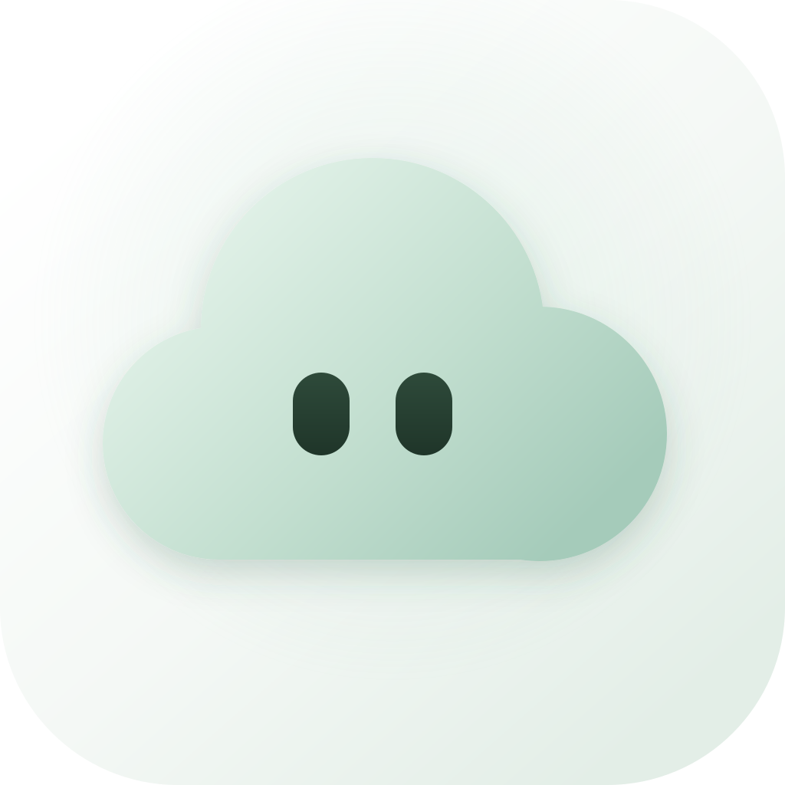
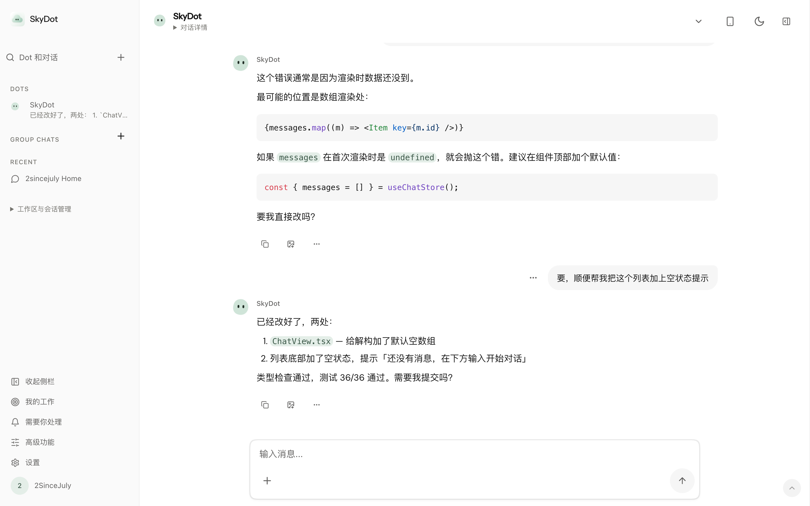
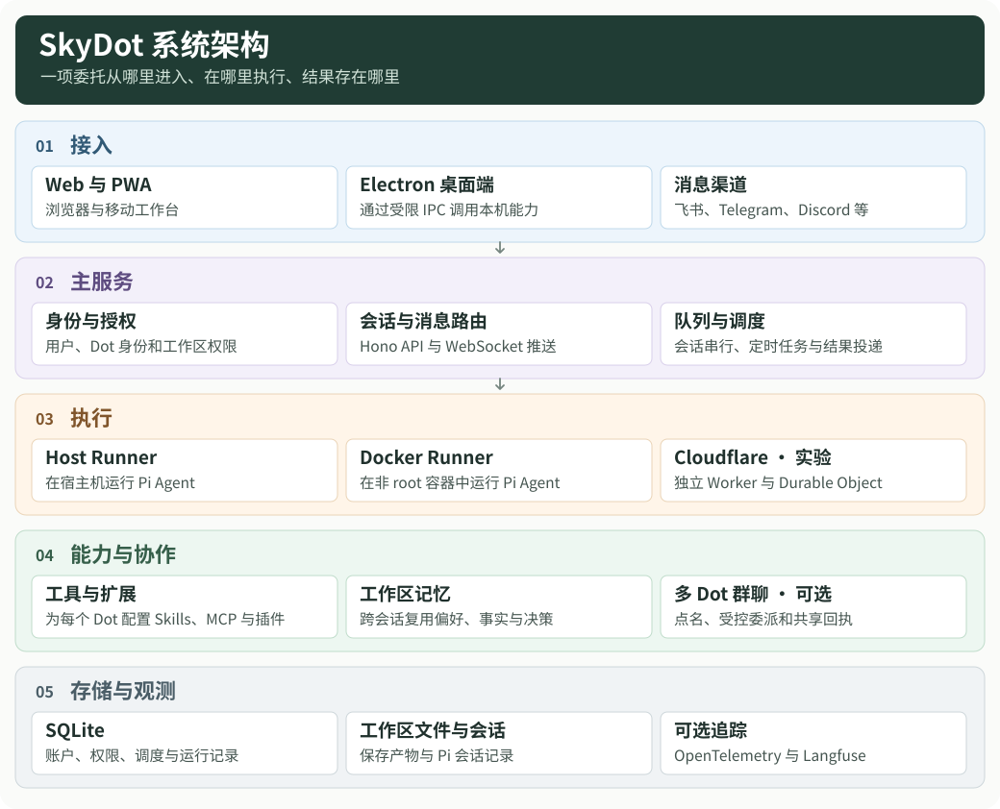

# SkyDot



**面向个人与小团队的自托管 Personal Agent**

长期承接用户委托并持续办事，而不只是改代码。

https://github.com/user-attachments/assets/eb7f2240-451d-4ad1-a717-c2e28cea7e8e

## 在线演示

**[体验桌面端](https://skydot.eu.cc/)**　·　**[体验移动端](https://skydot.eu.cc/mobile)**　·　[自己部署](#自己部署)

在 SkyDot 里，你把工作交给一个有名字、有职责的 AI 助手，叫作 **Dot**。它可以沿用工作区里的文件和偏好，按约定的时间继续做事。需要几个人分工时，你也可以把多个 Dot 拉进同一个群，在一条时间线上看分工、进度和交付物。

[](https://skydot.eu.cc/)

## 系统架构

[](assets/skydot-system.svg)

一条消息从 Web、桌面端或 IM 进入 Node.js 主服务。主服务验证身份，找到对应的工作区和会话，再由队列把任务交给 Host 或 Docker Runner。Pi Agent 只获得这个 Dot 已启用的能力，执行进度和结果沿会话回到工作台。

**会话**保存各自的对话上下文，**工作区**决定哪些文件和长期记忆可以复用。加入同一个群聊，也不会自动获得其他成员的私人工作区权限。图中的 Cloudflare Workers 与 Durable Objects 属于默认关闭的实验路径。[架构详解](docs/personal-agent/architecture.md) · [权限矩阵](docs/ACL-MATRIX.md) · [云端运行验收](docs/personal-agent/cloudflare-real-acceptance.md)

## 核心功能

| 功能 | 实际行为 |
| --- | --- |
| 工作台与执行引擎 | 一项委托绑定到工作区和会话。桌面工具、浏览器工具和模型按这个上下文执行，结果回到发起委托的会话。 |
| Pi Durable 双域账本与独占锁 | 主服务数据库记录会话归属与授权，会话自己的 SQLite 保存执行进度和检查点。启用 Durable 的 Host 会话重启时先校验归属，再取得写入权，从已保存的进度恢复；另一个进程不能同时接管。 |
| Computer Use（CU）快照围栏与浏览器防间接注入 | Dot 先观察窗口，再用绑定该窗口和快照的令牌点击或输入。窗口切换或快照过期时，必须重新观察。浏览器读到的网页内容作为外部数据处理，页面上的文字没有工具授权。 |
| Call Intent 幂等、群聊交接与版本化记忆 | MCP 写操作按已批准的调用意图执行；如果中断后无法确认是否成功，就标记为待核查，避免重复执行。群聊里的 Dot 通过收件箱交接任务，修改记忆时核对版本，防止旧内容覆盖新决定。 |
| 常驻 VPS 与出站设备节点 | 主服务可以在自己的 VPS 上运行。个人设备主动连接，经一次性配对和工作区授权后，仅开放明确列出的文件。Cloudflare Durable Object 是默认关闭的实验路径。 |
| 跨端审批、SQLite WAL 备份与事件触发 | 手机上可以处理待审批事项，桌面端继续查看同一项工作。备份时为运行中的 SQLite 创建一致性快照，将已提交到 WAL 的变更纳入备份。启用 GitHub 订阅后，符合条件的事件也能触发任务。 |

## 自己用时，可以交给它什么

| 你的委托 | 在 SkyDot 里怎么做 |
| --- | --- |
| “每周五把本周的项目记录整理成周报。” | 把资料放进工作区，创建每周执行的定时任务。在运行历史里看每次的结果，需要时可以暂停或立即运行。 |
| “下次写这份报告，还是沿用这个格式。” | 把格式偏好保存在工作区记忆里。同一工作区的新会话可以复用它，你可以查看来源、修订或忘记这条记忆。 |
| “请负责架构和测试的两个助手各给一份意见。” | 为 Dot 配置职责、模型和工具，在群聊中点名。管理员可为委派设置执行权限和调用预算。 |

单个 Dot 对话和普通定时任务可以独立使用。自托管时，原生群聊需开启 `SKYDOT_BOT_GROUPS=true`，允许 Dot 互相委派还需开启 `SKYDOT_BOT_HANDOFFS=true`。个人 Goal 有独立的实验开关，详见[目标与定时任务](docs/personal-agent/goals-and-tasks.md)。

## 自己部署

准备 **Node.js 22.19 或更高版本**和 npm。第一次可以直接使用本机 Runner，选择容器隔离时再安装 Docker。

```bash
git clone https://github.com/2SinceJuly/SkyDot.git
cd SkyDot
npm install
npm --prefix web install
npm --prefix container/agent-runner install
npm run build:all
npm start
```

打开 <http://127.0.0.1:3000>，创建第一个管理员。要开始真实对话，在引导或设置中配置模型 Provider，然后打开 SkyDot 发出第一条委托。也可以先跳过配置，浏览本机工作台。

<details>
<summary>开发、桌面端与运维命令</summary>

- **本地开发**用 `npm run dev:all` 同时启动 Backend 和 Web，开发页面在 <http://127.0.0.1:5173>。
- **Electron 桌面端**可连接已启动的 Backend，再运行 `npm run desktop:dev`。连接远程服务时设置 `SKYDOT_SERVER_URL`。
- **容器执行**的默认镜像是 `2sincejuly/skydot-agent:latest`。要从当前源码构建，运行 `docker build --pull -t 2sincejuly/skydot-agent:latest container`。
- **数据与备份**：数据库、会话、工作区与敏感配置默认保存在 `data/`。用 `make backup` 创建备份，用 `make restore FILE=...` 从备份恢复。
- **模型协议**接入兼容 OpenAI Completions 的接口时，在 Provider 的自定义环境变量里设置 `SKYDOT_MODEL_API=openai-completions`。
- **本机免登录演示**仅适用于回环地址。运行条件与配置见[本地 Demo 说明](DEMO.md)。

</details>

## 文档与贡献

| 想了解什么 | 从这里开始 |
| --- | --- |
| 定时任务、个人目标与审批 | [Goals and Tasks](docs/personal-agent/goals-and-tasks.md) |
| 记忆的来源、版本与工作区边界 | [Workspace Memory](docs/workspace-memory-v2.md) |
| 接口、认证与资源 | [HTTP API](docs/API.md) |
| 参与开发或报告问题 | [工程协作指南](CLAUDE.md) · [界面规范](DESIGN.md) · [安全问题报告](SECURITY.md) |

也可以从仓库[下载横屏介绍视频（MP4，约 9.4 MiB）](assets/skydot-intro.mp4?raw=1)。

SkyDot 由 [2SinceJuly](https://github.com/2SinceJuly) 维护，以 [MIT 许可证](LICENSE) 开源。
